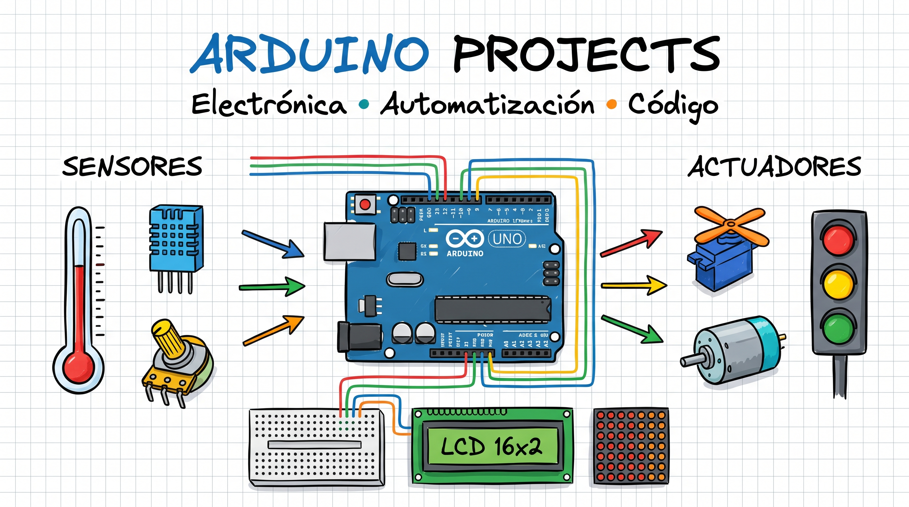

<div align="center">

# Arduino Projects by [@juanmariabravo](https://github.com/juanmariabravo)

### Laboratorio personal de electrónica, programación y automatización

**Colección de proyectos prácticos creados con Arduino UNO, sensores, actuadores y componentes del kit oficial.**

[](https://www.arduino.cc/)
[](https://www.arduino.cc/reference/en/)
[](https://www.arduino.cc/en/software)
[](./LICENSE)

</div>

---



Este repositorio contiene diversos proyectos diferentes categorías realizados con un kit de Arduino. Podrás explorar todos ellos y entender el funcionamiento paso a paso.
Cada proyecto contiene documentación sobre la la preparación, la configuración, el desarrollo y una demostración del resultado final.

Si te gusta la electrónica y la programación, este repositorio es perfecto para ti. ¡Diviértete explorando y aprendiendo!


> **18 áreas de proyecto** para aprender electrónica desde cero: medir, controlar, automatizar, detectar y jugar.

## 🎯 Qué encontrarás aquí

| Concepto | Aplicación |
|:---|:---|
| ⚡ Electrónica básica | Resistencias, LEDs, relés, motores y protoboard |
| 🌡️ Sensores | Temperatura, luz, llama, lluvia, inclinación y humedad |
| 🧠 Lógica y control | Estados, temporizadores, histéresis y entradas digitales |
| 🔔 Interacción física | Displays, teclados, mandos IR, RGB y zumbadores |
| 🤖 Automatización | Ventanas, persianas, riego, luces y alarmas |

## 🗂️ Explora los proyectos

### ✅ Completados

| Proyecto | ¿Qué demuestra? | Recursos |
|:---|:---|:---|
| [🚦 Semáforo](./Semáforo) | Máquina de estados, botón peatonal y temporización con `millis()` | Esquema · Diagrama · Wokwi |
| [📏 Medidor de resistencias](./Medidor-Resistencias) | Divisor de tensión y cálculo de resistencias desconocidas | Esquema · Código |
| [🎄 Belén Navideño](./Belén-Navideño) | Integración progresiva de fuego, motor y villancicos | README · 6 módulos · Vídeo |

### 🛡️ Seguridad y control

| Proyecto | Aplicación |
|:---|:---|
| [🔐 Cerradura inteligente](./Cerradura-inteligente) | Acceso mediante RFID y PIN |
| [🚨 Alarma antirrobo](./Alarma-antirrobo) | Detección perimetral y volumétrica |
| [🔥 Detector de incendios](./Detector-incendios) | Sensor de llama y activación de alarma |

### 🏠 Domótica y automatización

| Proyecto | Aplicación |
|:---|:---|
| [🌦️ Estación meteorológica](./Estación-meteorológica) | Temperatura, luz y datos en LCD |
| [🌧️ Cierre automático de ventanas](./Cierre-automático-ventanas) | Respuesta automática ante lluvia |
| [⏰ Reloj despertador digital](./Reloj-despertador-digital) | RTC, display de 7 segmentos y alarmas |
| [🪟 Persiana fotosensible](./Persiana-domótica-fotosensible) | Control luminoso con motor paso a paso |
| [💡 Luz de lectura inteligente](./Luz-lectura-crepuscular-inteligente) | Iluminación crepuscular regulable |
| [🌱 Control de riego](./Control-riego-automático) | Activación según humedad y horario |

### 🎮 Ocio e interacción

| Proyecto | Aplicación |
|:---|:---|
| [👾 Minijuegos retro](./Minijuegos-retro-matriz-LED-8x8) | Snake y Pong en matriz LED 8×8 |
| [🧠 Juego de memoria](./Juego-memoria-acústico-visual) | Secuencias visuales y acústicas |
| [📹 Pan-Tilt robótico](./Control-robótico-Pan-Tilt-cámara) | Posicionamiento de cámara con servo y joystick |

### 🔬 Instrumentación

| Proyecto | Aplicación |
|:---|:---|
| [📐 Tacómetro óptico](./Tacómetro-Contador-óptico) | Medida de revoluciones por minuto |
| [🌡️ Termostato con histéresis](./Termostato-digital-histéresis) | Control estable de temperatura |
| [📚 Fundamentos](./Fundamentos) | Resistencias, bandas de color y protoboard |

## 🔧 Tecnologías y componentes habituales

`Arduino UNO` · `C++` · `Arduino IDE` · `Sensores analógicos` · `I²C`

`DHT11` · `LDR` · `LM35` · `LED` · `LCD 16×2` · `RTC` · `RFID`

`Servomotores` · `Motores paso a paso` · `Relés` · `Buzzer` · `Matriz 8×8`

## 🚀 Cómo empezar

1. Instala el [Arduino IDE](https://www.arduino.cc/en/software).
2. Elige un proyecto y abre su carpeta.
3. Consulta el `README.md` y el esquema de conexiones.
4. Abre el archivo `.ino` desde el Arduino IDE.
5. Selecciona la placa **Arduino UNO** y el puerto serie correspondiente.
6. Compila, carga el programa y prueba el montaje.

## 🧭 Hoja de ruta

- [ ] Completar la documentación de los proyectos pendientes
- [ ] Incorporar esquemas y fotografías finales
- [ ] Añadir simulaciones Wokwi a más proyectos
- [ ] Normalizar nombres de carpetas y convenciones de código
- [ ] Añadir pruebas de montaje y listas de componentes

## 📦 Estructura del repositorio

```text
Arduino-Projects/
├── Fundamentos/
├── Semáforo/
├── Medidor-Resistencias/
├── Belén-Navideño/
├── Cerradura-inteligente/
├── Alarma-antirrobo/
├── Detector-incendios/
├── Estación-meteorológica/
├── Cierre-automático-ventanas/
├── Reloj-despertador-digital/
├── Persiana-domótica-fotosensible/
├── Luz-lectura-crepuscular-inteligente/
├── Control-riego-automático/
├── Minijuegos-retro-matriz-LED-8x8/
├── Juego-memoria-acústico-visual/
├── Control-robótico-Pan-Tilt-cámara/
├── Tacómetro-Contador-óptico/
└── Termostato-digital-histéresis/
```

<div align="center">

### Licencia

Este proyecto está publicado bajo la [Licencia MIT](./LICENSE).

**Diseñado para aprender, experimentar y seguir construyendo.**

</div>
